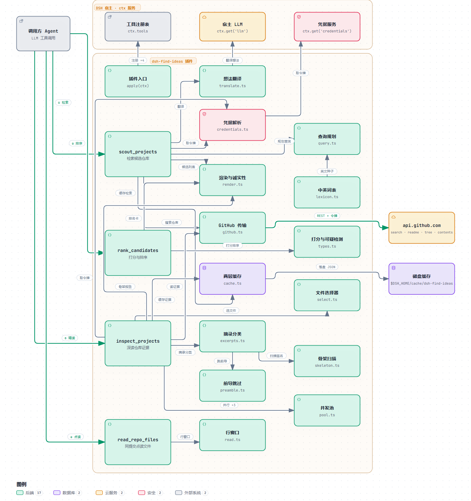

# dsh-find-ideas

  

English | [中文](README.zh.md)

**Before you build it, check whether it already exists.**

Describe your idea in one sentence. The agent searches GitHub for similar projects, ranks them by relevance weighted with stars, and hands back a card. Pick a few repositories from the card and it reads their README, dependency manifest, directory tree and key files, then writes up an architecture you can borrow from.

## Install

```sh
# from GitHub
dsh plugin --profile web add github:tianyao2003/dsh-find-ideas

# or from a local directory
dsh plugin --profile web add /path/to/dsh-find-ideas
```

Not published to npm.

### Configure a GitHub token (recommended)

GitHub limits unauthenticated search requests to **10 per minute per public IP**, and everyone behind the same egress IP shares that quota. A token raises it to **30 per minute**, counted per account.

The plugin reads `GITHUB_TOKEN` through DSH's credential store. Set it in the environment that launches DSH:

```sh
export GITHUB_TOKEN=ghp_...          # bash
$env:GITHUB_TOKEN = 'ghp_...'        # PowerShell, current session
```

Everything works without a token, but `inspect_projects` refuses an anonymous batch it estimates above 10 requests.

## Usage

Restart dsh after installing, then describe your idea — the agent calls the three built-in tools on its own:

- "I want to build a local-first Markdown note app — what's out there on GitHub?"
- "I want to build a UI-enhancing DSH plugin. Which projects exist?"

`scout_projects` → `rank_candidates` → `inspect_projects` are independent and share no state. The 0–10 relevance is the agent's judgement; the tools only search, compute, sort and read, and never judge semantic similarity. The ranking formula is `relevance × (1 + log10(max(stars, 10) + 1)) / 2`. A ranked card always has eight columns: rank, project, last updated, relevance, stars, score, language, description.

**Tool output is written in Chinese** — there is no locale switch.

## How it works



- **`scout_projects`** turns the idea into several GitHub search queries and returns a star-sorted pool — deliberately *not* ranked by relevance. When the idea contains no Latin letters it is translated into English search terms first; when that is impossible (the caller gave no Latin `keywords` and no LLM is available) it returns `plan_failed`.
- **`rank_candidates`** scores the pool with `relevance × (1 + log10(max(stars, 10) + 1)) / 2` and produces the card.
- **`inspect_projects`** reads up to 5 repositories — README, dependency manifest, tree summary and a few key files.

### What the cards guarantee

- **Computed and supplied stay apart.** The ranked card declares which fields the code derived and which the caller (the agent invoking the tool) passed in. Caller text is truncated, escaped and labelled `[未验证]`, and never enters the arithmetic.
- **A count nobody measured is never rendered as 0.** A query term that was never tested on its own reads 未知（未测得）; an archived field that is missing says 数据缺失; when the pool size was never measured the card reports only the reserved-seat count and never invents a total.
- **Third-party text is always data.** Repository excerpts are wrapped in code blocks and escaped, so a line of README cannot impersonate card structure; the only hosts emitted as links are `github.com` and `raw.githubusercontent.com`.
- **Failures come back as values.** Nothing throws out of a tool: every failure returns a `reason` and a `detail` you can act on, and a partial result says why it is partial.
- **A restatement keeps every column.** The card says so itself: keep all eight columns when you restate it — dropping a row or a column is losing information, not shortening the table.

### What leaves your machine

Search queries and repository paths go to `api.github.com`; `inspect_projects` only reads repository content on GitHub and never uploads your local code. The only other place data goes is the model that DSH itself uses, and only to translate an idea with no Latin letters when the caller supplied no Latin `keywords` — a purely English idea is never sent to a model for translation. Search results are cached for 24 hours and source reads for 10 minutes, both under `$DSH_HOME/cache/dsh-find-ideas/` locally.

## Compatibility

Requires Node ≥ 22. DSH plugin APIs are prerelease-versioned, so the `@deepseek-ai/dsh-tools` peer range names the versions it supports one by one (the last one is `^0.2.0-rc.1`); `npm run check:peers` resolves the `dsh-tools` version the current DSH host actually installs from the npm registry and fails when the range does not accept it.

## Version

| Version | Update |
| --- | --- |
| 0.2.0 (current) | The card states how many query channels found each row and how many rows on the board are archived, and writes the "keep all eight columns when restating" rule into the card itself. |
| 0.1.0 | First usable version: the `scout_projects` → `rank_candidates` → `inspect_projects` chain, and the rule that keeps computed fields apart from caller-supplied ones. |

## Development

```sh
npm install
npm run build         # tsc -> lib/ ; run this first, the tests import lib/
npm test              # node test/run-all.test.mjs
npm run typecheck     # tsc --noEmit
npm run check:peers   # check the peer range against the current DSH versions
```

`test/` holds 27 `*.test.mjs` files. `test/run-all.test.mjs` runs the 26 that are not itself, and two of those (`baseline`, `stage2`) skip because the recorded fixtures under `eval/runs/` were never ported — so a full local run verifies **24 files**. Skips are listed under `skipped (fixture absent, NOT verified)` and never counted as passes.

## Contributing

Stars are welcome, and so are contributions — issues and pull requests alike.

- **Report a problem or ask for a feature**: open an issue with the idea you typed, the result you expected and the result you got (tool output is Chinese; paste the card).
- **Contribution flow**: fork, branch off `master`, make the change with a test, run `npm run check && npm test` until green, then open a pull request.
- **Pull request rules**: one change per PR; a change to card wording also updates the contract in `.trellis/spec/` and its tests; commit messages use the `feat:` / `fix:` / `docs:` prefixes.

## License

MIT. See [LICENSE](LICENSE).
